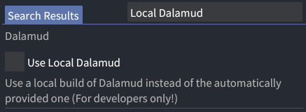

# Building Dalamud with MinGW

:::warning

This guide acts as supplementary information to the main
[Building Dalamud](/building/) page, and thus refers to steps from that page.

Dalamud's native components are maintained with the Windows SDK and MSVC in
mind.

**As such, this _will_ break from time to time.** Fixes are welcome though!

:::

## Building

### Build Prerequisites

- The base prerequisites from the main build page, except Windows and VS
- An x64 Linux environment, e.g. a 64-bit Linux OS on x64 hardware
  - This is not a hard requirement, but this page is written with this setup in
    mind.
- MinGW x64 `x86_64-w64-mingw32`, either GCC or LLVM
  - If you prefer LLVM, unpack / symlink
    [llvm-mingw](https://github.com/mstorsjo/llvm-mingw) to
    `Dalamud/tools/linux/llvm/` and it'll be used.
  - The CMake toolchain falls back to `x86_64-w64-mingw32-gcc` in PATH if
    nothing else is found.

Optionally, if you want to run the CI / Test target, set up a Wine prefix with
the following:

- [.NET 10.0 SDK for Windows x64](https://dotnet.microsoft.com/download/dotnet/10.0)
- [Git](https://git-scm.com/downloads)

### Build Steps

Follow the main build steps, but instead of `build.cmd`, run:

```bash
./build.sh
```

## Running

The build process will output the injector to `bin/Debug/Dalamud.Injector.exe`.
For testing purposes, you can follow the main page steps, or use the "Use Local
Dalamud" option in the XIVLauncher.Core settings.



## Debugging

A set of VSCode debugging default configurations is present, but the
configurations and prerequisites can be ported and reused to other debugging
environments, e.g. if you prefer using Ghidra as a gdb frontend.

### Debug Prerequisites

- [Samsung netcoredbg win64](https://github.com/Samsung/netcoredbg) in
  `Dalamud/tools/linux/netcoredbg/`
  - This is used for launching the C# injector with a debugger, as vsdbg
    struggles with launching.
- VSCode CoreCLR Windows x86-64 vsdbg in `Dalamud/tools/linux/vsdbg/`
  - This can be sourced from an existing VSCode Windows install, or using the
    [official download script](https://aka.ms/getvsdbgps1) (`win7-x64`).
  - This is used for attaching to the running game process to debug plugins, as
    netcoredbg struggles with attaching.
- [XIVLauncher.Core with PR 337](https://github.com/goatcorp/XIVLauncher.Core/pull/337)
  merged and **in PATH as `xlcore`** via a symlink, wrapper script, or similar.
- gdb, ideally compiled with support for `set osabi Windows`
- A symlink to the main .exe in `Dalamud/tools/linux/ffxiv_dx11.exe`
- DWARF debug symbols for the main .exe in
  `Dalamud/tools/linux/ffxiv_dx11.exe.dwarf`
  - For generating this, see
    [this patched version of ghidra-ExportDwarfELFSymbols](https://github.com/0x0ade/ghidra-ExportDwarfELFSymbols)
    for one possible method.
- Optionally: A bash script at `tools/linux/ffxivrc.sh` to override and export
  any env vars and tools you want, such as setting an alias for `xlcore`,
  overriding `DOTNET_ROOT` or `DOTNET_SYSTEM_GLOBALIZATION_USENLS`

### Launch Configurations

- **Launch Wine netcoredbg Dalamud.Injector with winedbg:**<br> Launches
  `Dalamud.Injector.exe` with `netcoredbg` with arguments set to launch FFXIV
  with `winedbg` in `gdbserver` mode. Can be used to debug the injector and to
  quickly launch the game itself for basic debugging.

- **Attach to FFXIV via gdb on localhost:12345:**<br> Can be used in combination
  with the previous launch configuration, or after launching the game via
  xlcore.

- **Attach to FFXIV via coreclr vsdbg:**<br> Attaches C# `vsdbg` to an already
  running game process launched via xlcore, useful for debugging Dalamud itself
  or any self-built plugins.

- **CMake configure:**<br> Configures `Dalamud/build` with a debugger attached.

- **Launch winedbg Debug DalamudCrashHandler and attach gdb:**<br> Launches and
  attaches a debugger to `DalamudCrashHandler` with no arguments. Useful to
  verify that winedbg and gdb are functional.

If you prefer using tooling other than VSCode, check the arguments and steps for
those launch targets in the launch.json configuration file.

## Quirks

MinGW does not support `#pragma comment` and `__try / __except` among other
things. Furthermore, header and library names are lowercase, and some parts of
std aren't being imported transitively as with MSVC, or don't support UTF-16
strings in the exact same way as MSVC.

Some are trivial to work around, such as `#pragma comment` and header
mismatches, while others require a bit more insight on how e.g.
`__try / __except` is used for SEH and doesn't map to normal C++ exception
handling by default.

Even if you don't have a Linux build environment, CI will flag most issues.
